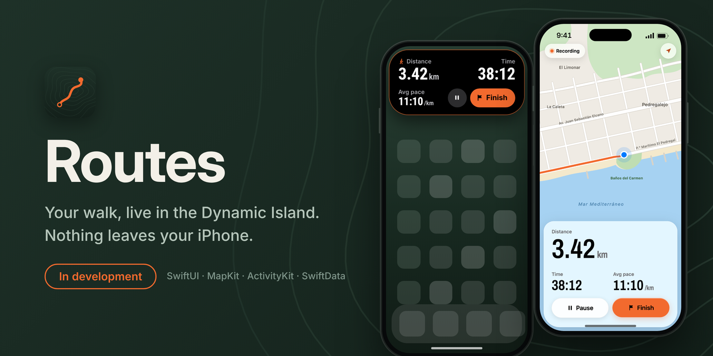

 

---

## 👨‍💻 About

Native iOS developer with production experience in **Swift, SwiftUI and UIKit**. I like apps that work well under the hood: clear architecture, well-isolated concurrency, and code that is easy to maintain and to explain.

🛠️ **Coffee King · Aug 2024 – Mar 2026** — Junior iOS Developer, then App Manager owning feature delivery for the native production iOS app with international teams: fewer crashes, faster releases and a tvOS prototype.

🔐 **Before that** — AppSec intern at Accenture (hardened Dockerfiles, Jenkins pipelines for security scanning) and iOS intern at ViewNext (billing app, architecture refactor, unit tests).

🎓 **Apple Coding Academy** — *Swift Developer Program*, finished in February 2026 with a **9/10**: Swift 6.2 and strict concurrency, SwiftUI and SwiftData.

🧱 **Now at 42 Málaga** — common core student since September 2026, writing C from scratch and defending every project in peer reviews. Libft, get_next_line and ft_printf done; now on push_swap.

🌍 **Open to new opportunities** — in Málaga or remote. EU citizen, no sponsorship needed in the EU; UK Skilled Worker visa welcomed.

---

## 🚀 Featured Projects

<table>
<tr>
<td width="50%" valign="top">

### 📚 [MangaVault](https://github.com/jlcl11/MangaVault)
> Manga collection manager for iPhone and iPad: JWT auth, offline-first sync, home screen widgets and Apple Intelligence reader profiles. Final project of Apple Coding Academy's Swift Developer Program (9/10).

`Swift 6` `SwiftUI` `SwiftData` `JWT + Keychain` `WidgetKit` `Foundation Models`

</td>
<td width="50%" valign="top">

### 💰 [XpenseTracker](https://github.com/jlcl11/XpenseTracker)
> UIKit expense tracker with Firebase Auth, Cloud Firestore, interactive charts and UI tests.

`UIKit` `Storyboards` `Firebase Auth` `Cloud Firestore` `Charts` `XCUITest`

</td>
</tr>
</table>

### 🚧 Now building: Routes

A walk tracker with live distance, time and pace in the Dynamic Island and on the Lock Screen: `CLLocationUpdate`, ActivityKit, App Intents, MapKit and SwiftData, in Swift 6 with strict concurrency. Nothing leaves the iPhone. The repo opens with version 1.

### 🧱 42 Málaga · Common core

| Project | What it is |
|---|---|
| [libft](https://github.com/jlcl11/libft) | My own C library: part of libc rewritten from scratch (`memmove`, `strlcat`, `calloc`…), plus `split`, `itoa`, file-descriptor output and linked lists. The later projects build on it. |
| [get_next_line](https://github.com/jlcl11/get_next_line) | Returns the next line of a file descriptor on each call, keeping the leftover bytes in a static buffer between calls. The bonus keeps one buffer per descriptor to read several at once. |
| [ft_printf](https://github.com/jlcl11/ft_printf) | `printf` from scratch with `<stdarg.h>`: `%c %s %p %d %i %u %x %X %%`, plus width, precision and the `-`, `0`, `.`, `#`, `+` and space flags in the bonus. No `malloc`, no buffer. |

Written in C under the 42 Norm with `-Wall -Wextra -Werror`, and evaluated by other students line by line. **Next: push_swap** — sorting integers with two stacks and a small instruction set, in as few moves as possible.

### Older projects

- [Ghibli Films](https://github.com/jlcl11/Ghibli-films) — Studio Ghibli explorer with SwiftData and a `ModelActor` (2026).
- [MyWorld](https://github.com/jlcl11/MyWorld) — MapKit place finder with Look Around and walking routes (2024).
- [RecipeLookUp](https://github.com/jlcl11/RecipeLookUp) — recipe browser for Apple Vision Pro (visionOS, 2024).

---

## 🛠️ Tech Stack

### Languages & Platforms

### UI · Frameworks · Concurrency

### Architecture & Practices

### Tools

---

<picture>
  <source media="(prefers-color-scheme: dark)" srcset="https://raw.githubusercontent.com/jlcl11/jlcl11/output/github-contribution-grid-snake-dark.svg" />
  <source media="(prefers-color-scheme: light)" srcset="https://raw.githubusercontent.com/jlcl11/jlcl11/output/github-contribution-grid-snake.svg" />
  
</picture>

---

## 🎓 Currently Learning

- **C and systems programming** at 42 Málaga — pointers, manual memory management and, with push_swap, sorting algorithms
- **ActivityKit and Live Activities** — Routes lives in the Dynamic Island and on the Lock Screen
- **Liquid Glass** (iOS 26) — the design language Routes is built with
- **Swift 6.2 strict concurrency** — actors and isolation domains, with no data races

---

## 📫 Let's Connect

  

Built with ☕ + Xcode in Málaga · *Recruiters, the projects above link to live repos with full READMEs and code.*

